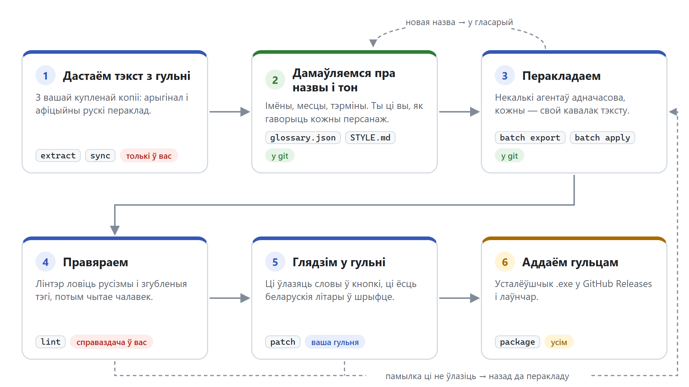
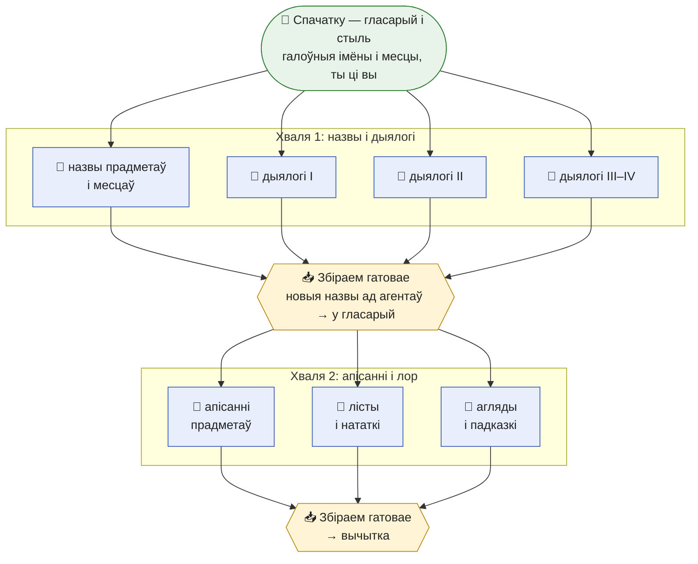
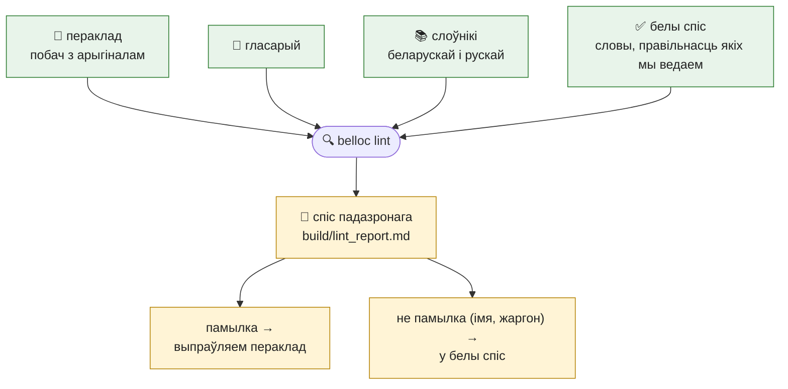

# belloc — беларускія пераклады гульняў

Інструменты, з якімі мы перакладаем гульні на беларускую мову, і самі
пераклады. Тут можна выправіць памылку ў перакладзе, дадаць новую гульню ці
навучыць інструменты новаму рухавіку.

> **Пераклады — нейрапераклад**: іх робіць моўная мадэль, чалавекам яны цалкам
> не вычытаныя. Калі заўважылі абдрукоўку ці дзіўную фразу — адкрыйце issue або PR.

**Мадэль для перакладу — толькі топавая** (зараз — Claude Opus 5.5). Слабейшыя
мадэлі часцей калькуюць рускія звароты, блытаюць род і ты/вы, губляюць тэгі і
плэйсхолдары — лінтэр ловіць не ўсё, і вычытка такога перакладу даражэйшая за
розніцу ў кошце мадэлі.

## Пагуляць па-беларуску

**[Спампаваць лаўнчар → Releases](https://github.com/stopthatnoise/belloc/releases/latest)**

Прасцей за ўсё — лаўнчар: ён сам знойдзе гульні Steam з перакладам, паставіць і
абновіць яго. Або асобны ўсталёўшчык гульні — па спасылцы ў табліцы.

| гульня | пераклад |
|---|---|
| Silver Pines | **[1.1](https://github.com/stopthatnoise/belloc/releases/tag/silver-pines-v1.1)** |
| Pony Island | **[1.0](https://github.com/stopthatnoise/belloc/releases/tag/pony-island-v1.0)** |
| 007 First Light | **[1.1](https://github.com/stopthatnoise/belloc/releases/tag/007-first-light-v1.1)** |
| Indiana Jones and the Great Circle | **[0.9.1](https://github.com/stopthatnoise/belloc/releases/tag/indiana-jones-great-circle-v0.9.1)** — праверка ў гульні працягваецца |
| Probably Stolen | **[0.9](https://github.com/stopthatnoise/belloc/releases/tag/probably-stolen-v0.9)** — праверка ў гульні працягваецца |

Усе выпускі — у [Releases](https://github.com/stopthatnoise/belloc/releases). Windows можа
папярэдзіць пра невядомага выдаўца (exe не падпісаны): «Падрабязней» → «Усё роўна
запусціць».

## Што тут ляжыць

```
core/belloc/     ядро: CSV перакладу, лінтэр, гласарый, пачкі, слоўнікі, рухавікі гульняў
games/<гульня>/  пераклад, гласарый, стыль і канфіг кожнай гульні
installer/       усталёўшчык для гульцоў
launcher/        лаўнчар: знаходзіць гульні Steam з перакладам, ставіць і абнаўляе (акно і кансоль)
docs/            як перакласці новую гульню, заданне агенту, рухавікі
dicts/           наш слоўнік рэальных назваў: артыкул Вікіпедыі → беларускі артыкул
local/           (не ў git) тэксты і файлы вашай копіі гульні, рабочыя файлы, слоўнікі
```

## Як гэта працуе

Пераклад гульні ідзе ў шэсць крокаў. Механічную працу робяць каманды `belloc`,
перакладае моўная мадэль, а чалавек кіруе і правярае.



**Тэкст гульні застаецца ў вас.** Англійскі арыгінал і рускі пераклад гульні
ляжаць толькі на вашым камп'ютары, у `local/`. У git трапляе толькі наша: для
кожнага радка — яго ключ, беларускі тэкст і «адбітак» арыгінала (хэш). Па
адбітку відаць, калі распрацоўшчык змяніў радок у абнаўленні: тады пераклад
пазначаецца на перагляд.

### Як праца дзеліцца паміж агентамі

У гульні тысячы радкоў, і адзін агент перакладаў бы іх тыднямі. Таму тэкст
наразаецца на кавалкі — **пачкі**: «дыялогі гэтых персанажаў», «апісанні
прадметаў», «лісты і нататкі». Кожную пачку бярэ свой агент. Агенты працуюць
адначасова і адзін аднаму не замінаюць: кожны піша толькі ў свой файл.

Над імі — **каардынатар**: галоўная сесія Claude Code, з якой гаворыце вы. Ён
раздае пачкі, збірае гатовае і вядзе гласарый.

Пачкі ідуць **хвалямі**. Спачатку — назвы і дыялогі, потым — тэксты, дзе гэтыя
назвы ўжываюцца: так прадмет у апісанні завецца так сама, як у інвентары.
Прыклад — Silver Pines:



- **Агент** перакладае толькі сваю пачку. Новую назву, якой няма ў гласарыі,
  ён не ўпісвае туды сам, а прапануе ў сваіх нататках. Сумненні пакідае ў
  заўвазе да радка. Перад тым як здаць працу, праганяе лінтэр па сваёй пачцы.
- **Каардынатар** збірае пачкі ў агульныя табліцы, вырашае, якія з прапанаваных
  назваў пайсці ў гласарый, і толькі пасля гэтага запускае наступную хвалю.

Каманды — `batch export` перад хваляй і `batch apply` пасля; заданне агенту —
[docs/agent-brief.md](docs/agent-brief.md).

### Як працуе лінтэр

Лінтэр — аўтаматычны карэктар. Сэнсу ён не разумее, затое не стамляецца:
праглядае ўсе радкі і пазначае падазронае. Ён ведае беларускі і рускі слоўнікі —
таму заўважае словы, якія ёсць у рускай, але не ў беларускай. Ён бачыць
арыгінал — таму заўважае, калі ў перакладзе згубіўся тэг. Ён ведае гласарый —
таму заўважае, калі імя перакладзена іначай.



| што лавіць | праверка |
|---|---|
| апіскі і словы, якіх няма ў беларускім слоўніку | `spell`, `names` |
| русізмы: слова з рускага слоўніка, літары и, щ, ъ, канчаткі -ть, -тся | `ruwords`, `ruletters`, `rusuffix` |
| «у» там, дзе мусіць быць «ў» | `ushort` |
| забытая англійская: слова ці цэлы радок | `latin`, `untranslated` |
| **згублены тэг ці плэйсхолдар** (`<b>`, `{0}`) або прабел па краі — такі радок ламаецца ў гульні, таму гэтыя праверкі мусяць быць чыстыя | `tags`, `placeholders`, `ws` |
| назва перададзена не так, як у гласарыі | `glossary` |
| адзін і той жа радок перакладзены па-рознаму | `dupes` |
| падазрона кароткі ці доўгі пераклад, іншы знак у канцы | `lenratio`, `endpunct` |

Чаго лінтэр не бачыць: ці жывая фраза, ці правільны род, ты ці вы. Гэта
правярае чалавек. Для слоў, падобных на рускія, ёсць даведнікі:
`belloc antykalka слова` — адпаведнікі без калек, `belloc idioms ‹гульня›` —
устойлівыя выразы, якія маглі перакласці даслоўна. Рэальныя назвы (людзі, рухі,
культуры, месцы) — `belloc wiki "Holy See"`: як называецца беларускі артыкул
Вікіпедыі, на які спасылаецца артыкул мовы арыгінала.

## Тэкстаў гульняў тут няма

У рэпазіторыі — толькі беларускі пераклад па ключах радкоў. Арыгінальны тэкст
і афіцыйныя пераклады гульні кожны здабывае са сваёй купленай копіі
(`belloc extract`): гэта чужыя творы, і публікаваць іх мы не можам. Падрабязна — у
[AGENTS.md](AGENTS.md).

## Як пачаць перакладаць

### Выправіць памылку — без праграм

1. Знайдзіце фразу пошукам па рэпазіторыі на GitHub (клавіша `/`) — па
   беларускім тэксце, як ён у гульні. Яна ляжыць у
   `games/<гульня>/translation/<табліца>.csv`.
2. Аловак **Edit** → правіце толькі слупок `bel` (трэці), `key` і `src_hash` не
   чапаеце, двукоссі захоўваеце → **Propose changes** → **Create pull request**.
   GitHub сам зробіць вам копію рэпазіторыя.

### Перакласці гульню або дапамагчы з перакладам

Трэба: Windows, [Python 3.12](https://www.python.org/downloads/), [git](https://git-scm.com/),
купленая гульня ў Steam і [Claude Code](https://claude.com/claude-code) з топавай мадэллю.

```bash
git clone https://github.com/stopthatnoise/belloc
cd belloc
python -m venv .venv
.venv/Scripts/python -m pip install -e ".[lint,unity]"   # рухавік гульні: unity, glacier, unreal, telltale
.venv/Scripts/python -X utf8 -m belloc dicts             # слоўнікі лінтэра, раз
.venv/Scripts/python -X utf8 -m belloc extract silver-pines
.venv/Scripts/python -X utf8 -m belloc sync silver-pines # CSV + колькі перакладзена
```

Гульню `extract` шукае ў Steam сам; калі не знайшоў — пакладзіце шлях у
`local/<гульня>/local.json`: `{"game_dir": "D:/…"}`.

Далей адкрыйце ў гэтай папцы Claude Code — ён сам прачытае правілы з
[AGENTS.md](AGENTS.md). Скажыце, што рабіць: «перакладзі пачку `<пачка>` гульні
`<гульня>` па docs/agent-brief.md» або «давай перакладзём новую гульню па
docs/new-game.md». Потым:

```bash
.venv/Scripts/python -X utf8 -m belloc lint silver-pines   # → local/silver-pines/build/lint_report.md
.venv/Scripts/python -X utf8 -m belloc patch silver-pines  # у гульню; --restore вяртае арыгінал
```

Пагуляйце, паглядзіце, як выглядае, і адпраўце PR — толькі `translation/*.csv`,
`glossary.json`, `STYLE.md` (і `dicts/wikipedia.json`, калі правяралі назвы). Нічога з `local/` у PR не трапляе: там тэкст гульні.
Увесь шлях па кроках — [docs/new-game.md](docs/new-game.md).

## Слоўнікі і падзяка

Наша праца стаіць на ручной працы людзей, якія гадамі складалі слоўнікі і
граматычныя базы беларускай мовы. Без іх лінтэр не адрозніў бы русізм ад
беларускага слова, а пераклад тэрмінаў фэнтэзі быў бы здагадкай. Дзякуй!

| слоўнік | аўтары | для чаго ў нас |
|---|---|---|
| [hunspell-be](https://github.com/375gnu/hunspell-be) | праект 375gnu | арфаграфія (`spell`, `names`) |
| [GrammarDB](https://github.com/Belarus/GrammarDB) — граматычная база беларускай мовы | праект Belarus/GrammarDB | ~2 млн словаформ: каб лінтэр ведаў усе формы слоў |
| [«Антыкалька»](https://antykalka.org/) — Новы расейска-беларускі слоўнік | Алег Мінкін | адпаведнікі без калек, устойлівыя выразы (`antykalka`, `idioms`) |
| [«Дапаможнік для перакладчыкаў фэнтэзі»](https://www.patreon.com/by_reservation) | МТГ «RэЗервацыЯ» | тэрміны фэнтэзі і D&D (`fantasy`, `fantasy-report`); CC BY-SA 4.0 |
| [hunspell ru_RU](https://github.com/LibreOffice/dictionaries) | праект LibreOffice | рускі слоўнік — каб лавіць русізмы (`ruwords`) |
| [spylls](https://github.com/zverok/spylls) | Victor Shepelev | hunspell на Python — праверка арфаграфіі на Windows |
| [Беларуская Вікіпедыя](https://be.wikipedia.org/) | удзельнікі Вікіпедыі | як завуцца рэальныя назвы па-беларуску (`wiki`); CC BY-SA 4.0 |
| [Вікіданыя](https://www.wikidata.org/) | удзельнікі Вікіданых | што гэта, пол чалавека, беларускія меткі без артыкула (`wiki`); CC0 |

Чужыя слоўнікі ў рэпазіторый не кладуцца: `python -m belloc dicts` спампоўвае іх з
першакрыніц, кожны — пад сваёй ліцэнзіяй. Свой ёсць адзін —
[dicts/wikipedia.json](dicts/wikipedia.json): назвы, якія мы ўжо праверылі па
Вікіпедыі (загаловак артыкула мовы арыгінала → беларускі і рускі артыкулы, пра што
гаворка, наша заўвага, калі пішам інакш — «Святы Пасад», а не «Святы Прастол») і па
Вікіданых (тып, пол, беларуская метка, калі артыкула няма).
`belloc wiki` спачатку глядзіць у яго, а чаго няма — пытае Вікіпедыю і дапісвае;
новыя запісы ідуць у PR разам з перакладам, дзе іх ужылі. Калі слоўнік нам дапамог або мы
знайшлі ў ім памылку — пішам аўтарам: так ён становіцца лепшым для ўсіх.

## Чужы код, на які мы абапіраемся

| праект | аўтары | што ў нас |
|---|---|---|
| [TTG Tools](https://github.com/HeitorSpectre/TTG-Tools) (GPL-3.0) | Den Em, Pashok6798; форк HeitorSpectre | разбор `.landb`, `.font`, `.d3dtx`, Lua Telltale — па іх кодзе (`core/belloc/engines/telltale/`) |
| [ooz](https://github.com/powzix/ooz) праз [pyooz](https://github.com/zao/pyooz) (GPL-3.0) | Powzix; zao | распакоўка Oodle ў паках Unreal; кола для exe і лаўнчара збіраем самі з замацаваных камітаў (`.github/workflows/pyooz.yml`), поўныя зыходнікі — у рэлізе `pyooz-0.0.8.1` |
| [UnityPy](https://github.com/K0lb3/UnityPy) (MIT) | K0lb3 | чытанне і запіс файлаў Unity |
| [fontTools](https://github.com/fonttools/fonttools) (MIT) | праект fontTools | беларускія літары ў шрыфтах |

## Ліцэнзія

- **Код** (`core/`, `installer/`, `tests/`) — [GPL-3.0-or-later](LICENSE). Частка кода
  зроблена па TTG Tools і ooz, якія самі пад GPL, таму і ўвесь belloc — пад GPL:
  змены і форкі таксама застаюцца адкрытымі.
- **Пераклады** (`games/`) — [CC BY-SA 4.0](games/LICENSE.md): можна браць і
  змяняць, пазначыўшы аўтарства і захаваўшы ліцэнзію.
- Гульні, іх тэкст і афіцыйныя пераклады належаць іх аўтарам і тут не публікуюцца.

## Аўтары

Кіраўнік праекта: Віталь Аляхновіч.
